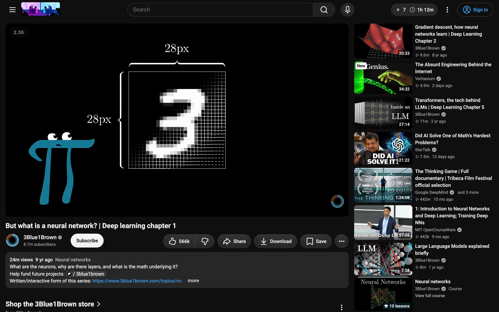
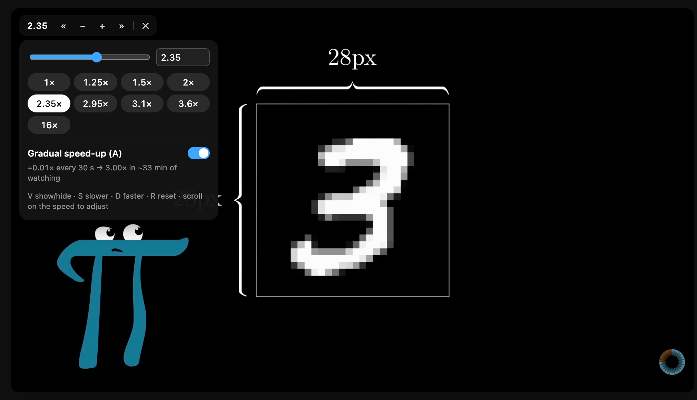
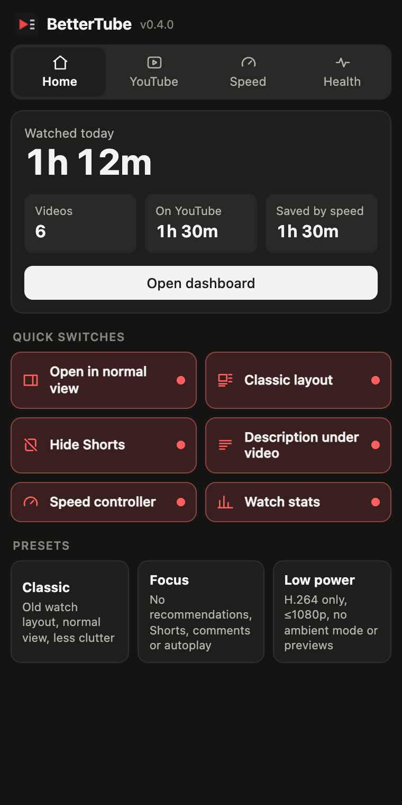
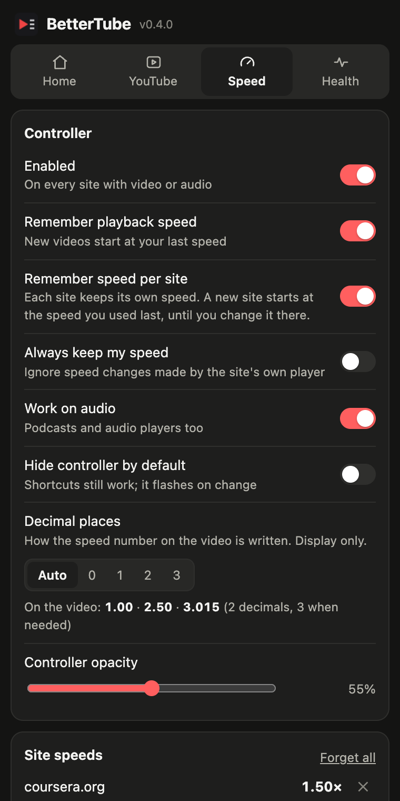
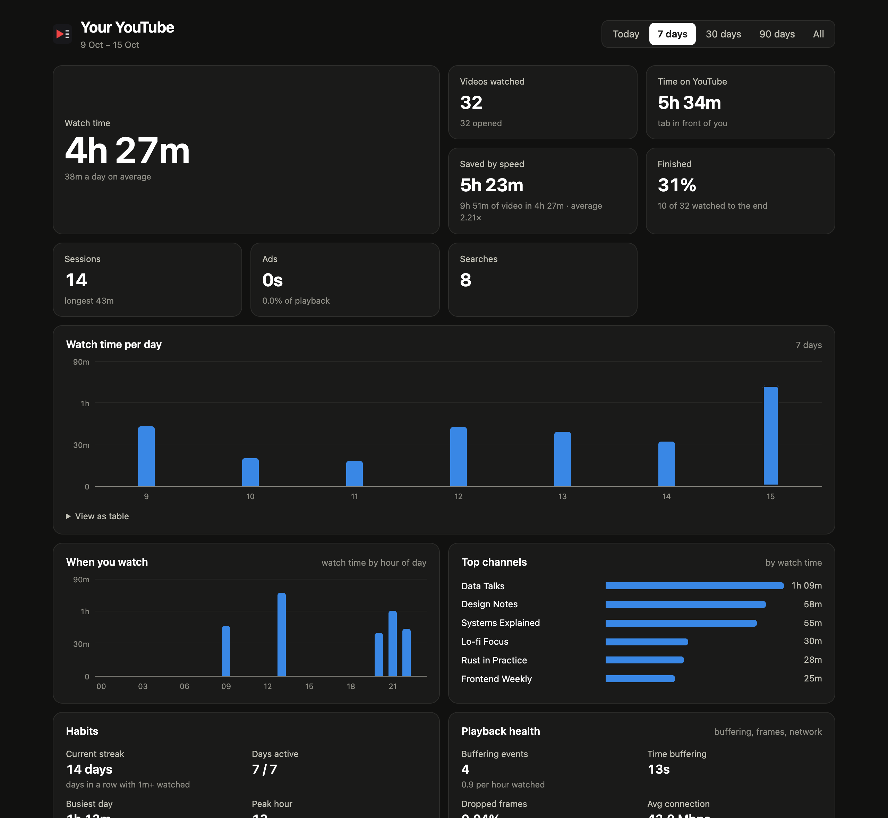

<div align="center">


# BetterTube

**Puts YouTube's watch page back the way you like it, gives every video and audio player on the web a fast, precise speed controller, and shows you where your watching time goes.**

[](https://github.com/Naman503/bettertube/actions/workflows/ci.yml)
[](https://github.com/Naman503/bettertube/releases)


[](LICENSE)



</div>

---

## Why

In 2025–26 YouTube moved its desktop watch page around a lot.

- **Theater on open:** videos open in a wide, theater-like mode.
- **Up-next as a grid:** "up next" became a two-column grid of giant thumbnails that can sit on top of the player.
- **Description hidden:** the description moved behind a side rail.
- **Clutter:** Shorts and AI buttons appear everywhere.

There's no setting to turn any of it off.

BetterTube fixes this at the source: it switches off the experiment flags behind the new layout, so **YouTube itself draws the classic page**. It also adds the tools a heavy viewer wants: speed control everywhere, gradual speed-up, and honest stats.

## Highlights

| | |
|---|---|
| 🎬 **Classic YouTube** | Normal view on open, one compact up-next column, description and comments under the video, a real theater toggle, a draggable player width. |
| ⚡ **Speed controller for every site** | Video and audio on any site, including players hidden in frames or created off-page. 0.07×–16×, your own shortcuts, a different speed per site. |
| 📈 **Gradual speed-up** | Speed creeps up a tiny bit while you watch (e.g. +0.01× every 30 s) up to your max. Too small to notice, but it adds up. |
| 📊 **Watch stats** | Videos and watch time in YouTube's top bar, plus a dashboard: time saved by speed, habits, top channels, playback health. |
| 🧹 **Declutter** | No Shorts, AI "Ask" button, end cards, "Continue watching?" prompts or ambient glow. |
| 🔋 **Lighter playback** | Blocks AV1 on Macs without hardware decoding (M1/M2, Intel). Steps quality down when a video keeps buffering. |
| 🔒 **Private** | No accounts, servers or analytics. Everything is stored in your browser. |

## Screenshots

<table>
<tr>
<td width="56%"></td>
<td width="22%"></td>
<td width="22%"></td>
</tr>
<tr>
<td><sub><b>Speed overlay and panel:</b> click the number for a slider, presets and exact entry.</sub></td>
<td><sub><b>Popup:</b> today at a glance, with quick switches.</sub></td>
<td><sub><b>Speed tab:</b> every option, shortcuts, site speeds.</sub></td>
</tr>
</table>



<sub>Dashboard shown with demo data.</sub>

## Install

BetterTube isn't on the Chrome Web Store yet; install it in a minute from a release.

1. Download **`bettertube-v0.4.0.zip`** from the [latest release](https://github.com/Naman503/bettertube/releases/latest) and unzip it.
2. Open `brave://extensions` (or `chrome://extensions`) and turn on **Developer mode** (top right).
3. Click **Load unpacked** and pick the unzipped folder.
4. Pin BetterTube from the extensions (puzzle) menu, and reload any open YouTube tabs.

> **Coming from Video Speed Controller?** Turn it off in the extensions page. BetterTube's controller uses the same default keys and steps aside while VSC is running, so both don't change the speed at once.

## Features

### YouTube watch page

- **Opens in normal view.** It turns off the 2026 flags that make every video start wide (`disable_theater_mode`, `web_side_rail_default_dismissed_panels`), so the size button is a real theater toggle again. A fallback corrects a late switch for the first seconds of each video, and your own toggle, `T`, `F` and fullscreen are always respected.
- **Classic layout.** It switches off split-scroll and the percentage-width sidebar (`web_watch_split_scroll`, `web_side_rail_dismissible_panels`, …), so up-next is one column of 402 px beside the player. A measuring fixer catches anything the flags miss.
- **Player size.** Drag the divider between the video and up-next to any width, or set it in the popup. Theater height is adjustable too.
- **Description under the video** when YouTube moves it into a side panel. Links, timestamps and hashtags are clickable.
- **Declutter.** Hides Shorts everywhere and opens `/shorts/` links in the normal player. Also hides the AI "Ask" button and summaries, end-screen cards, hover previews and the ambient glow. Optionally turns autoplay off, and skips "Video paused. Continue watching?"
- **Home feed:** choose 3–6 videos per row.

### Speed controller (every site)

A small overlay sits on every video. Hover it for « − + » ✕, click the number for the panel, drag it anywhere, or scroll on it to adjust.

| Key | Action | Key | Action |
|:-:|---|:-:|---|
| `S` / `D` | Slower / faster by 0.05× | `G` `H` `Y` `P` `U` | Preferred speeds 3.1 · 2.95 · 3.6 · 16 · 2.35 (press again to go back) |
| `Z` / `X` | Back / forward 10 s | `R` | Reset to 1× (press again to go back) |
| `V` | Show / hide the overlay | `A` | Gradual speed-up on / off |
| `Q` | Stop speed-up for this video (press again to resume) | `W` | Pause speed-up for 10 min (any duration) |

Every key, value and action is editable in **Popup → Speed → Shortcuts**.

- **Per-site memory.** YouTube can stay at 3×, a course site at 1.75× and a podcast at 1.5×. A site you haven't set a speed on starts at your last speed anywhere, and an embedded player follows the page it's on.
- **Reaches everything:**
  - `<video>` and `<audio>`, including audio played without being on the page (`new Audio()`);
  - media inside web components;
  - players in cross-origin iframes, with keys handed between the page and the frame.
- **Acts on the right one.** Shortcuts go to what you're watching or hearing; muted previews and background videos are ignored.
- **Display options:** decimal places (Auto, or 0–3), opacity, start hidden, and a per-site off list. "Always keep my speed" stops sites resetting it.

### Gradual speed-up

The speed climbs while you watch, measured in real playback time, so pauses and ads don't count.

- **Fully adjustable:** step, interval (s / min / h) and max all accept any value. The popup estimates how long the climb takes, e.g. "1.00× → 2.50× in about 1 h 15 min of watching".
- **Carries over:** the next video continues where the last one got to.
- **You stay in control:**
  - **Pause and resume by key:** each shortcut can pause or resume the climb. `R` pauses; `D` and the preferred speeds resume. A pause lasts across videos until you resume.
  - **Quiet zone:** no climbing between two speeds you choose, e.g. 1–2× while listening to music.
  - **Stop or pause on demand:** `Q` stops the climb for the current video only; `W` pauses it everywhere for a set time and it resumes by itself. Both are also in the speed panel (5 / 10 / 30 / 60 min) and the popup.
  - **Rewinding** eases the speed down 0.05× and pauses the climb for a minute.
  - **Short videos** under 2 minutes, which covers most clips and ads, are skipped.

### Watch stats

- **Top-bar badge:** today's videos and watch time in YouTube's top bar. Hover for details, click for the dashboard. An optional daily limit fills a progress line.
- **Dashboard:**
  - watch time, videos and time on YouTube;
  - **time saved by speed** (video covered − real time, with the math shown);
  - completion, sessions, ads time and searches;
  - charts by day and by hour, top channels, and habits (streak, peak hour);
  - playback health: buffering, dropped frames, connection, resolution and codec mix;
  - a video log and JSON export.
- **Accuracy:** checked against ground truth while the speed keeps changing (within 1.5%). Ticks from several open tabs are merged, so time is never counted twice.

### Performance

- **Codec filter:** *Auto* blocks AV1 unless your Mac has an M3 or newer; *H.264 only* is lightest on battery but caps at 1080p.
- **Avoid buffering:** two stalls within 90 s step the quality down one level, with an on-screen notice.

## Privacy

BetterTube has **no servers, accounts or analytics**.

- **Where data lives:** settings are in `chrome.storage.sync`; stats and site speeds are in `chrome.storage.local`. Nothing leaves your browser.
- **Retention:** stats are kept for 400 days and can be exported or cleared from the dashboard.
- **Incognito:** everything works the same, but nothing is recorded. No watch stats, no diagnostics snapshot, and your normal site speeds and pause state are left alone. Speeds you set in incognito start from your normal ones, are kept in memory only (`chrome.storage.session`), and are forgotten when you close your last incognito tab. To use it, turn on **Allow in Incognito** in `brave://extensions` (or `chrome://extensions`) → BetterTube → Details.
- **Permissions:**

| Permission | Why |
|---|---|
| `storage` | Settings, stats, site speeds |
| `alarms` | Development builds check for a rebuild every 30 s |
| `youtube.com` | The YouTube fixes and stats |
| All sites (content script only) | The speed controller, which works on any site with video or audio (except Netflix) |

## Troubleshooting

<details>
<summary><b>The layout still looks wrong on my account</b></summary>

YouTube runs A/B tests per account. Open a video, then open the popup → **Health** → **Copy diagnostics**, and attach the JSON to an [issue](https://github.com/Naman503/bettertube/issues). It includes the page structure and the experiment flags in play. Changes to layout flags apply after a page reload.
</details>

<details>
<summary><b>Shortcuts do nothing on a site</b></summary>

- **Typing:** make sure no text field has focus; shortcuts are ignored while typing.
- **Off list:** check the site isn't in **Popup → Speed → Turned off on these sites**.
- **Two controllers:** the popup warns if Video Speed Controller is still running.
- **Not covered:** sound generated with the Web Audio API (no media element, e.g. some games) and media inside *closed* shadow roots.
</details>

<details>
<summary><b>Netflix</b></summary>

BetterTube doesn't run on Netflix at all. Its player went black with the speed controller attached, so Netflix keeps its own controls (speed up to 1.5×).
</details>

<details>
<summary><b>"BetterTube was updated. Reload this tab"</b></summary>

After an update, scripts already running in open tabs are cut off from the extension. Reload the tab to pick up the new version.
</details>

## Development

**Requirements:** Node 22, and ffmpeg for two media tests.

```bash
git clone https://github.com/Naman503/bettertube.git
cd bettertube/extension
npm install
npm run build     # bundles to extension/dist; load that folder unpacked
npm run dev       # rebuild on save; unpacked builds reload themselves within ~30 s
```

| Command | What it does |
|---|---|
| `npm run typecheck` | TypeScript, strict |
| `npm run build` | esbuild bundle to `dist/` |
| `npm run package` | Build, then zip `dist/` as `bettertube-v<version>.zip` |
| `npm run test:smoke` | 38 end-to-end checks on live YouTube in Playwright Chromium (layout, view mode, speed keys, stats, Shorts…) |
| `npm run screenshots` | Regenerate the README screenshots (demo data) |

More end-to-end suites (Playwright, local test media generated with ffmpeg):

| Test | Covers |
|---|---|
| `tests/media-everywhere.mjs` | Off-page audio, iframes both ways, shadow DOM, main video vs muted preview |
| `tests/site-speeds.mjs` | Per-site memory, new sites, embeds, global mode |
| `tests/ramp.mjs`, `tests/ramp-controls.mjs` | Gradual speed-up: steps, max, carry-over, rewind easing, pause/resume keys, quiet zone |
| `tests/stats-ramp.mjs`, `tests/stats-seek.mjs` | Saved-by-speed vs ground truth; jumps not counted |
| `tests/user-layout-sim.mjs` | Recreates the signed-in 2026 side-rail layout via its flags and checks the fix |
| `tests/popup-amounts.mjs` | Free-entry fields in the popup |
| `tests/netflix.mjs` | Netflix left alone; videos played before being attached stay in their player |
| `tests/incognito.mjs` | Incognito: no stats, separate session-only speeds, wiped on close (uses an unpacked-only simulation flag) |

Set `CHROMIUM_PATH` to reuse an already-downloaded Chromium.

### How it's built

```
extension/src/
├── main/          YouTube page world, document_start: experiment-flag overrides, codec filter, player API bridge
├── content/       YouTube isolated world: one module per feature
│   └── modules/   viewMode · classicLayout · sidebarFix · density · playerSize · description · shorts · declutter · stats
├── speed/         speed controller for every site (isolated) + main.ts (page-world play() hook)
├── background.ts  service worker: merges stats from all tabs, routes keys between frames
├── dashboard/     stats dashboard page
├── popup/         popup / options page (settings generated from schema.ts)
└── shared/        settings, speed settings, stats model, messaging
```

- **Fix the cause, not the symptom.** A page-world script edits YouTube's `EXPERIMENT_FLAGS` before the app reads them. That's how the classic layout and real theater mode come back.
- **Cheap on every page.** The speed controller uses no MutationObservers. It finds media through their own events, creates an overlay only for videos that load, and shares one stylesheet across all overlays.
- **Modules.** Each YouTube feature is a module with `css()`, `init`, `onPage` (runs on every in-app navigation), `onVideo` and `check`. The last one feeds the Health tab.

Background research and the original plan are in [`docs/`](docs/). The version history is in [`CHANGELOG.md`](CHANGELOG.md).

## Related

**[PiP Anywhere](https://github.com/Naman503/pip-anywhere):** a macOS floating window that stays on top of full-screen apps, for watching while you work.

## License

[MIT](LICENSE) © 2026 Naman
